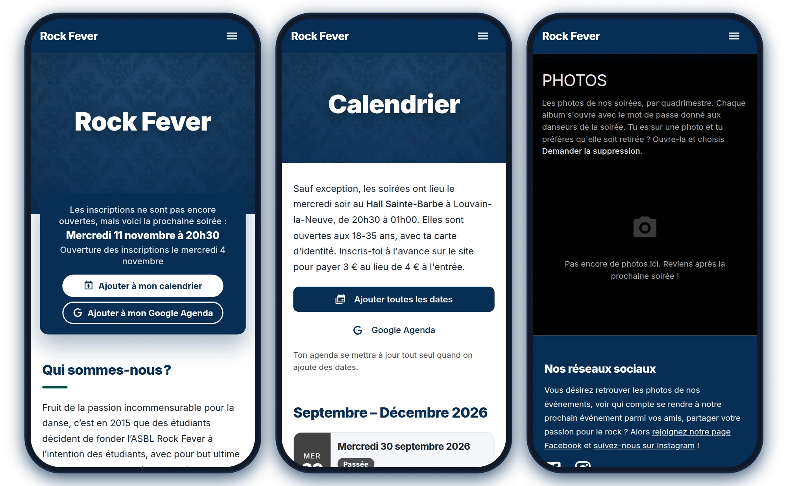
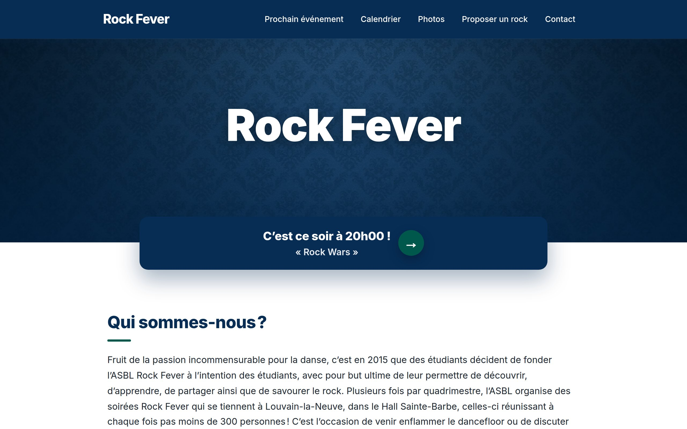

<a href="https://rockfever.be"></a>

<p align="center">
  <a href="https://rockfever.be"></a>
  <a href="https://github.com/rockfeverLLN/rockfever/actions/workflows/deploy.yml"></a>
  <a href="https://github.com/rockfeverLLN/rockfever/actions/workflows/test.yml"></a>
  <br>
  
  
  
  
</p>

# Rock Fever

The website of **Rock Fever**, the student ASBL that has been running rock (and waltz) dance nights, the soirées, at the Hall Sainte-Barbe in Louvain-la-Neuve since 2015, open to anyone aged 18 to 35. On the site, dancers find the next soirée and sign up for it, propose songs and get the photos; the team runs everything from its admin.

PHP 8.5, Twig 3, PHP-DI 7, Mezzio router, on OVH web hosting. Every push to `main` goes live.

<p align="center">
  
</p>

<details>
<summary><b>On a computer</b></summary>
<br>

</details>

### What's on the site

| Page | For | What it does |
| --- | --- | --- |
| [`/`](https://rockfever.be) | Everyone | Who we are, the next soirée, the coming dates and the staff |
| [`/calendrier`](https://rockfever.be/calendrier) | Everyone | Every soirée of the quadrimestre, to add to a calendar in one click (`.ics` feed) |
| [`/event`](https://rockfever.be/event) | Dancers | Sign up for the next soirée (3 € instead of 4 € at the door), from a week before |
| [`/photos`](https://rockfever.be/photos) | Dancers | The soirées' photo albums, each behind its own password |
| [`/music`](https://rockfever.be/music) | Dancers | Propose a song for the soirées |
| [`/contact`](https://rockfever.be/contact) | Everyone | Write to the team |
| `/admin` | The team | Events and the sign-up list at the door, home page sections, songs, photos, users |

### Contents

[Layout](#layout) · [Run it locally](#run-it-locally) · [Calendar](#calendar) · [Home page](#home-page) · [Statistics](#statistics) · [Photos](#photos) · [Facebook posts](#facebook-posts) · [Page speed](#page-speed) · [Search engines and AI agents](#search-engines-and-ai-agents) · [Deploy](#deploy) · [Package updates](#package-updates) · [README screenshots](#readme-screenshots)

## Layout

| Path | What it is |
| --- | --- |
| `www/` | Web root (`index.php`, CSS, JS, images) |
| `src/` | Application modules (`Main`, `Events`, `Photos`, `Auth`, `Admin`) and the small `Framework` |
| `views/` | Shared Twig layouts |
| `config/` | App config. `database.php` holds the DB credentials and is not in git |
| `src/*/db/` | Phinx migrations and seeds |

## Run it locally

```bash
brew install php composer mariadb
composer install
cp config/database.example.php config/database.php   # then fill in a local database
composer migrate
composer seed
composer serve                                       # http://127.0.0.1:8000
```

`composer serve` runs with `ENV=dev`, which shows errors with Whoops. Without `ENV`, the app runs in production mode and caches templates in `tmp/`.

## Calendar

`/calendrier` lists the dates of the soirées, with buttons to add one or all of them to a calendar app. The dates are planned in the admin, on **Événements > À venir** (`/admin/events`): add the next semester's dates there (no theme needed: a first date, **Jusqu'au** a last one and **Semaine** "S1" add the same weekday every week, S1, S2…; dates already planned are skipped), then create each one's event (theme, description, Facebook) from its **Créer l'événement** button when its sign-up nears. A soirée that won't happen gets **Soirée annulée** rather than being removed. **Passées** lists the events that are over. The usual times, place, address, prices and sign-up opening are the page's **Réglages des soirées** (admins only).

**In Instagram and Facebook:** their own browser can't hand a `.ics` file or a `webcal:` link to the phone's calendar. There, `www/js/script.js` sends those links and the Google Agenda ones to the real browser instead (`x-safari-https:` on iOS, an `intent:` URL on Android; a `webcal:` link gets the page, whose button then subscribes). If the page is still on screen 1.5 seconds later, [`views/inAppBrowser.twig`](views/inAppBrowser.twig) explains how to open it by hand.

**Settings:** [`Settings`](src/Main/Settings.php) lists every setting of the site with its label, type and default; each is a row of the `values` table. The soirées' are edited on `/admin/events`, the others (contact address, Facebook and Instagram links, R.O.I. and conditions) on **Paramètres > Réglages** (`/admin/values`). A setting never saved has its default, and saving it adds its row, so a new setting needs no SQL. Templates read them with `setting('NAME')`. The old `DEFAULT_WALTZTIME`, `DEFAULT_ROCKTIME`, `DEFAULT_PLACE` and `DEFAULT_PRICE` rows are no longer read. The dates are in the `soirees` table: on OVH, run [`src/Events/db/create-soirees-table.sql`](src/Events/db/create-soirees-table.sql) once in phpMyAdmin **before deploying**. `/calendrier.ics` serves them all, so calendars that subscribed to it get the new dates on their own.

**One source for every soirée:** [`Calendar`](src/Main/Calendar.php) builds each soirée from its planned date and its event in the admin (same day): the event's title (its theme), description, waltz and rock times and place win when they're set, the settings give the rest (the usual waltz and rock times, so every soirée has both). Before the team publishes it, a soirée's `themeNote` says when its theme will be announced, so agents read the date, times, place and prices as confirmed rather than guesses. The home page, `/calendrier`, `/event` and its form, the `.ics` files, the schema.org markup, the sitemap and `/api/events` all read these records, so they can't disagree. Each soirée has its own page, `/calendrier/2026-11-11`, its canonical URL. Prices are the settings' only: old events keep the "Prix" text they were created with, shown for past soirées that weren't planned dates. The event form asks for the title, date, times and description; the place (empty: the usual one), Facebook event and photos password are optional.

The same dates feed the home page, so nothing there needs editing when a soirée is over:

- **Sign-ups open on their own** as **Réglages des soirées** says (by default 7 days before at midnight: `REGISTRATION_DAYS`, `REGISTRATION_OPEN_TIME`) but not before the previous soirée is over, once its event exists in admin > Événements: the team can create it as early as it likes. They **close** at `REGISTRATION_CLOSE_TIME`, `REGISTRATION_CLOSE_DAYS` days before (empty: when the soirée starts, the default; never after it ends), and `/event` then refuses sign-ups. Every page says when in the same words (`registration.until`, `Calendar::getRegistrationRule()`). Only the next soirée can have them open. Each soirée's state is `open`, `upcoming`, `pending` (opening day reached, no event in the admin yet), `closed` or `cancelled`. The lock in the admin still closes them by hand (and reopens them), and the dashboard says whether they're open, closed or when they open. Before the opening, `/event` shows the soirée without the form and refuses sign-ups.
- **Next soirée card** under the header of the home page, which follows the sign-ups: "Inscris-toi à la soirée du …" while they're open; before that, "Les inscriptions ne sont pas encore ouvertes, mais voici la prochaine soirée : Mercredi 11 novembre à 20h30", with the opening day (to `/event` if the event exists, else `/calendrier`); "Prochaine soirée : …" once they're closed. Past soirées never show. On `/calendrier`, the card only appears while sign-ups are open, and the next soirée says when they open.
- **Date list:** a paragraph containing only `[dates]` in an "À propos" section (the "Dates de nos soirées" one) is replaced by the coming soirées, grouped by quadrimestre, with the next one marked. When they're all past, it says the next dates are coming. Don't type dates by hand in that section.

## Home page

The home page shows the sections of the admin's "À propos" in order. The sections after the one titled **Le Staff** each present a member: they are shown side by side as cards (photo, name, then text), so keep that title, or change it in [`HomeAction`](src/Main/Actions/HomeAction.php). In a member's text, the first paragraph with a photo becomes the top of the card. Sections with no title and nothing visible (a commented-out video) are skipped.

Text written in the admin (these sections, the events' title and description) goes through the `typography` Twig filter ([`TextExtension`](src/Framework/Twig/TextExtension.php)), so it follows French typography whatever was typed: no-break spaces before `:` and inside `« »`, narrow ones before `; ! ?`, and `’` apostrophes. Use it on any new admin text (`|e|typography` for plain text).

**Emojis:** the production tables were created in `utf8` (utf8mb3), which saves emojis as `?`. [`src/Main/db/fix-home-copy.sql`](src/Main/db/fix-home-copy.sql) converts `aboutSections` and `events` to utf8mb4, puts `[dates]` in the dates section and fixes the spelling of the home page. Run it once in phpMyAdmin after deploying; running it again changes nothing.

## Statistics

`/admin/statistics` counts the dancers of the past soirées, over all time or one season. The sign-ups have no id but the typed name, so [`DancerNames`](src/Events/DancerNames.php) decides who is who: the same name whatever its case, accents, hyphens or apostrophes is one dancer.

**Matching names:** **corriger les noms**, on that page, opens `/admin/statistics/names`. It lists the pairs that look like one dancer (same letters, first and last name swapped, a typo, a shortened name), surest first. Each answer saves at once: **Même personne** keeps the name in bold, the one used most, and **Deux personnes** stops suggesting the pair. **Tout regrouper** answers every pair with the same letters at once. A nickname it can't find goes in **Rapprocher deux noms**. Only the statistics change: the sign-ups and the soirées' lists keep what was typed, and every choice can be undone at the bottom of the page. The choices are in the `dancer_matches` table: on OVH, run [`src/Events/db/create-dancer-matches-table.sql`](src/Events/db/create-dancer-matches-table.sql) once in phpMyAdmin **before deploying**.

## Photos

`/photos` is a gallery of the soirées' photos, each album behind its soirée's password (the [`Photos`](src/Photos) module). It's dark, like a photographer's gallery: `/photos` lists the albums by collection, and each album (`/photos/semaine-5-26-27`) has a breadcrumb, its photographer, a button to download it all as a .zip, tabs, and the photos in columns, uncropped.

- **Albums:** one per soirée ("Semaine 5 26-27"), in a collection (the quadrimestre: "Q1-26-27"), with an optional photographer, linked to its event. They're listed by their soirée's date, newest first (albums without a soirée, by when they were made), and albums without photos aren't shown. The cover is the first photo, or the one picked with ☆ on the album's admin page. When uploading, an optional **tab** ("Photobooth") puts the photos in a tab of the album, next to "Toutes les photos".

- **Passwords:** each event has a "Mot de passe des photos" (admin > Événements), given to its dancers: it opens the album linked to that event, and only that one. It's kept readable so the team can find it again, and typed case-insensitively. Visitors who give it get a cookie for that album for 30 days; changing it locks out everyone who used the old one. Albums without an event, or whose event has no password, are only for the team (logged in) and aren't listed. Until an album is opened, `/photos` shows a lock in place of its cover. Five wrong passwords from one address in 10 minutes block the form there for a while (counted in `tmp/throttle/`, like the logins: five in 15 minutes). The pages are `noindex` and `Disallow`ed in `robots.txt`.
- **Upload and delete:** on `/admin/photos`, for everyone logged in: make an album, then drop the photos on its page: the browser makes them smaller (2400px) and sends them one by one, so the server's upload limit isn't a problem. The server keeps 480, 960 and 1600px WebP copies for the grid and the viewer, and saves photos again without their EXIF data (GPS position).
- **Storage:** `storage/photos/`, outside the web root and not in git, so the files are only sent by [`PhotoFileAction`](src/Photos/Actions/PhotoFileAction.php) to visitors with the password. `bin/deploy.sh` never touches that folder: back it up with the database.
- **Photographers:** the **Photographe** login (pick it on `/login`) only opens `/admin/photos`: albums, uploads and deletes. Every other admin page sends it back there, and it never shows the soirées' passwords or the deletion requests. Logged in, photographers see every album on `/photos` without a password. Give it a password, and change it, in Paramètres > Utilisateurs: until then nobody can log in with it. The role comes from a migration; on OVH, run [`src/Photos/db/add-photographer-role.sql`](src/Photos/db/add-photographer-role.sql) in phpMyAdmin.
- **Descriptions:** under each photo on its album's admin page, a sentence saying what it shows: screen readers read it for the photo in the album and in the viewer (the photo's text alternative, WCAG 1.1.1). Each is saved as soon as it's written; Enter goes to the next photo. The column comes from a migration; on OVH, run [`src/Photos/db/add-photo-description.sql`](src/Photos/db/add-photo-description.sql) in phpMyAdmin **before deploying**.
- **Deletion requests:** in the viewer, "Demander la suppression" sends a name, an optional email and a message. The team gets an email at `CONTACT_EMAIL`, a card on the dashboard, and the request on `/admin/photos`, where it can delete the photo or ignore the request.
- **Database:** the tables (and the events' `photos_password` column) come from a Phinx migration. With no SSH on OVH, run [`src/Photos/db/create-photos-tables.sql`](src/Photos/db/create-photos-tables.sql) once in phpMyAdmin before deploying.

## Facebook posts

In admin > Événements, pasting the link of the Rock Fever Page's post that announces a soirée (any link Facebook gives: *Copier le lien*, the post's date, a photo) fills the event's description with the post's text, to read over before saving. The link itself isn't saved. [`FacebookPosts`](src/Events/FacebookPosts.php) looks for it among the Page's 50 latest posts with the Graph API.

It has to be a post: Facebook only lets its Marketing Partners read events, so an event's link (`facebook.com/events/…`) can't fill anything. That one still goes in the "Lien vers l'événement Facebook" field.

**Setting it up, once.** The site reads the posts with a token of the Page, made by someone who is an admin of the Page:

1. On [developers.facebook.com](https://developers.facebook.com/apps), create an app (use case: *Other*, type: *Business*). Leave it in development mode: its admins can use it without App Review.
2. In the [Graph API Explorer](https://developers.facebook.com/tools/explorer), pick that app and *Generate Access Token* with the permissions `pages_show_list`, `pages_read_engagement` and `pages_read_user_content`, choosing the Rock Fever Page.
3. Paste that token into the [Access Token Debugger](https://developers.facebook.com/tools/debug/accesstoken) and click *Extend Access Token*.
4. Back in the Explorer, with the extended token, run `GET me/accounts` and copy Rock Fever's `access_token`. The debugger should say it *never* expires.
5. Over SFTP, add it to the server's `config/database.php`: `'facebook.page_token' => '…',` (the file stays on the server and isn't in git).

The token stops working if its owner leaves the Page's admins, changes their Facebook password, or deletes the app: the form then shows Facebook's reason, and steps 2 to 5 make a new one.

Facebook posts are full of emojis: if they come out as `?`, run [`src/Events/db/events-utf8mb4.sql`](src/Events/db/events-utf8mb4.sql) once in phpMyAdmin.

## Page speed

- No CSS or JavaScript framework. `www/css/base.css` holds the base styles (grid, helpers, colors, cards, buttons, top bar, side menu, forms, tables): the rules of Materialize 1.0 (MIT, its project stopped in 2018) that the public pages and the admin use, kept readable and now ours to change; `style.css` comes after it with the site's own design. `www/js/script.js` drives the widgets with plain JavaScript and the classes Materialize's CSS styles: side menu, the admin's dropdown, parallax headers, tooltips, modals (`<dialog class="modal">`, opened by a `.modal-trigger` link to them), collapsibles, card reveals, floating labels and growing text areas. Dates and times use the browser's own pickers (`field(…, {type: 'date'})`), selects are native. `www/js/guests.js` runs the sign-up list at the door. There's no jQuery: write new scripts the same way, without inline `onclick=` attributes.
- `views/critical.css` holds the CSS rules the public pages need for their first paint: `layout.twig` inlines it and loads the full stylesheet in the background. That stylesheet, `www/css/site.css`, is the part of `base.css` the public pages use (plus the classes `script.js` adds) followed by `style.css`, in one file so both apply at once (about 37 KB, against 94 KB for both); the admin loads all of `base.css`. Both files are built by `bin/critical-css.php` at every deploy, from this commit's pages on a test database and from the live pages, so they're not in git. Without them (a fresh checkout), the pages load all of `base.css` and `style.css` the usual way. To build them locally: `php bin/critical-css.php https://www.rockfever.be http://127.0.0.1:8000`. A class of `base.css` that no page used when it was made isn't in it: copy the rule from Materialize 1.0.0's `materialize.css` if a page needs it.
- `script.js` starts loading once the browser reports the first paint, so on slow connections it doesn't delay it (the menu and forms work a moment later).
- CSS and JS URLs carry a version made from the file (`asset()` in `layout.twig`, [`AssetExtension`](src/Framework/Twig/AssetExtension.php)), so `www/.htaccess` lets browsers keep them for a year: a changed file gets a new URL.
- `www/fonts/material-icons.woff2` and `www/fonts/mdi.woff2` only contain the Material Icons and Material Design Icons (`mdi mdi-…`) used in the templates. After using a new icon, run `bin/subset-icons.sh` (needs `brew install fonttools`): it rebuilds both fonts, the `mdi-…` rules at the end of `www/css/style.css`, and the `?v=` of the font URLs.
- The public pages use Inter, self-hosted in `www/fonts/inter.woff2` (Latin characters, one variable file for every weight, license in `inter-LICENSE.txt`). `layout.twig` preloads it; if you replace the file, change its `?v=` there and in `www/css/style.css`.
- Photos uploaded in the admin are scaled down to 1600px, and smaller WebP copies (320 to 1280px) are saved in `www/images/about/sizes/`. The `lazyImages` Twig filter offers them in a `srcset` for images that have a `width`. For photos uploaded before that, run `php bin/resize-images.php`. An image pasted into the editor rather than uploaded is kept in the text as base64: `lazyImages` saves it once in `www/images/about/pasted/` (not in git) and points to that file, so it doesn't weigh down every page.
- Reading the session doesn't start one ([`PHPSession`](src/Framework/Session/PHPSession.php)): a visitor's pages come without a session cookie and without PHP's `no-store` headers, so browsers can show them again instantly from their back/forward cache. A session starts when something is saved in it (a sign-up, a message, a login).
- The Google tag (`G-MKKLSTRX4W`) is Google's standard snippet at the top of `<head>` of every public page (`views/layout.twig`; not the admin), loaded `async` so it doesn't block the page. Consent Mode grants `analytics_storage` with no banner: with it denied, GA4 doesn't report the visits of a site this small (it only models them above 1,000 consenting users a day). Ads storage stays denied. An action queues an event for the next page with `FlashService::event()`: `sign_up` (registration), `generate_lead` (contact message) and `music_request` (music suggestion). Mark them as key events in GA (Admin > Events). After a sign-up, `/event` opens a popup to add the soirée to a calendar: its buttons send `add_to_calendar` (`method`: `ics` or `google`), closing it without them `add_to_calendar_dismiss` (`data-track` on a link, `data-track-close` on a dialog, in `www/js/script.js`). Compare them to `sign_up` to see how many add it. To filter by `method` in GA's reports, register it as a custom dimension (Admin > Custom definitions, event scope).

## Search engines and AI agents

- `www/robots.txt` lets every crawler in, AI training included (`Content-Signal: ai-train=yes`), except `/admin` and `/login`.
- `www/llms.txt` sums up the site and its pages for language models, and `www/AGENTS.md` tells agents what they may do (no form sent without the person's request). Update them when pages change.
- Every page answers in Markdown (its `<main>` only) when asked with `Accept: text/markdown`: [`MarkdownMiddleware`](src/Framework/Middleware/MarkdownMiddleware.php).
- `layout.twig` marks up Rock Fever as a schema.org `Organization`. The home and calendar pages list the coming soirées as `DanceEvent`s, and `/event` and each soirée's page mark up theirs, all from `Calendar::toSchema` (dates with their offset, address, both prices with the sign-up's availability, `EventCancelled` for a cancelled one).
- `/api/events` gives every soirée as JSON, past and to come (`Calendar::toApi`), with `next`, `nextSummary` (the next soirée in one sentence) and `suggestions` (what an assistant can offer next: add it to a calendar, a reminder when its sign-ups open, subscribe to every date; `Calendar::toSuggestions`), each one's `summary`, `theme` and `themeNote`, sign-up state, opening and closing times, and the fields the form needs.
- `/mcp` is a [Model Context Protocol](https://modelcontextprotocol.io) server, so assistants can read the soirées and sign someone up without opening the site: [`McpAction`](src/Main/Actions/McpAction.php) speaks the protocol, [`McpTools`](src/Main/McpTools.php) holds the tools. In ChatGPT, add `https://rockfever.be/mcp` as a custom MCP server with *No authentication*. A sign-up takes two steps, `prepare_registration` (saves nothing) and `confirm_registration`, under the same rules as the form of `/event`. A sign-up is an ordinary line of the door list: nothing else is kept, so cancelling goes through the team, and the answer doesn't show whether a name was already on the list. There is no login, as on the form, so the protection is a limit per IP address (`McpTools::MAX_SIGN_UPS`). The site also offers its forms to agents in the visitor's own browser with WebMCP (`registerForm.twig`): that one needs the visitor on the page, `/mcp` doesn't.
- `/sitemap.xml` is built by [`SitemapAction`](src/Main/Actions/SitemapAction.php): the public pages and the page of each soirée still to come. Past soirées' pages and `/music` are `noindex`, so search results (and Google's sitelinks) only show what's coming.
- `www/.htaccess` sends the security headers (HSTS, CSP, nosniff…) on every response.

## Deploy

Every push to `main` runs [`.github/workflows/deploy.yml`](.github/workflows/deploy.yml). It installs the Composer dependencies, checks PHP syntax, runs PHPStan and `bin/smoke-test.sh` on a copy of the site with a test database, and only then uploads the project over SFTP to the OVH hosting root: a push that fails a check doesn't go live. It needs the `FTP_PASSWORD` repository secret.

The PHP version on OVH is set in [`.ovhconfig`](.ovhconfig).

## Package updates

Updates install themselves, major versions included, with no one needing to do anything. Every night, Dependabot ([`.github/dependabot.yml`](.github/dependabot.yml)) looks for new versions of the Composer packages (for the PHP version in `composer.json`'s `config.platform`, the server's) and of the JavaScript libraries: TinyMCE, its French translation, clipboard.js and Masonry, loaded from jsDelivr at the versions in [`package.json`](package.json), which `cdn()` in the templates reads (nothing is installed with npm; the site's own scripts and styles use no library). Minor and patch releases come in one pull request per ecosystem, each major version in its own. A release isn't offered the day it comes out: Dependabot waits a few days first (its cooldown, visible as "Filtered out … due to cooldown" in its "Dependabot Updates" runs in the Actions tab), so a broken or hijacked release is usually withdrawn before it reaches the site.

Every pull request is tested on a copy of the site by [`.github/workflows/test.yml`](.github/workflows/test.yml) (`bin/test.sh`): PHP syntax, PHPStan, every main page answering (`bin/smoke-test.sh`) and their scripts working in Chrome (`bin/browser-test.mjs`: the side menu, dropdown, tooltips, collapsibles, modals, the date fields, the list at the door, TinyMCE, the gallery). A Dependabot pull request that passes is merged and deployed; one that fails stays open with its test output and the site stays on the previous version, until a newer release replaces it or the code is changed to work with it.

The JPEG XL encoder the server uses (`cjxl`, from libjxl's GitHub releases, which Dependabot can't follow) is pinned in [`bin/cjxl.version`](bin/cjxl.version). Every Monday, [`.github/workflows/update-cjxl.yml`](.github/workflows/update-cjxl.yml) raises it to libjxl's newest release, checked against the SHA-256 GitHub gives for the file, and deploys it once `bin/fetch-cjxl.sh` has tested that it makes JPEG XL copies the way the site does.

To run the same checks locally: `composer migrate && composer seed`, `composer serve`, then in another terminal `bin/smoke-test.sh`, `node --experimental-websocket bin/browser-test.mjs` (Node 20; plain `node` from 22) and `composer analyse`.

## README screenshots

The screenshots at the top of this README come from the live site and update themselves: after every deploy, and every Monday for what changes from the admin, [`.github/workflows/readme-screenshots.yml`](.github/workflows/readme-screenshots.yml) runs [`bin/readme-screenshots.mjs`](bin/readme-screenshots.mjs), which opens rockfever.be in headless Chrome, takes the home page on a computer (`desktop.jpg`) and the home page, the calendar and the photos on phones (`phones.webp`), and commits them when the page looks different. To change which pages the phones show, edit `PHONE_PAGES` in the script. The banner isn't a screenshot and stays as it is. To take them by hand: `node --experimental-websocket bin/readme-screenshots.mjs` (plain `node` from 22).

## License

The code is open source under the [Apache License 2.0](LICENSE). The Inter font keeps its own license ([`www/fonts/inter-LICENSE.txt`](www/fonts/inter-LICENSE.txt)), and the photos and the Rock Fever name and logo stay Rock Fever's.
